# System architecture

RAG Evidence Lab is a local-first PDF question-answering and evaluation application. It separates document processing, passage retrieval, answer generation, evaluation, and result storage so retrieval behavior can be measured independently from the language model.

## End-to-end flow

```mermaid
flowchart LR
    PDF[User PDF collection] --> Extract[Local PDF extraction]
    Extract --> Pages[Page text + SHA-256 provenance]
    Pages --> Chunk[Tokenizer-based chunks + source offsets]
    Chunk --> BM25[BM25 lexical retrieval]
    Chunk --> Dense[Dense embedding retrieval]
    BM25 --> Fusion[Hybrid RRF fusion]
    Dense --> Fusion
    BM25 --> Rerank[Optional CrossEncoder reranking]
    Dense --> Rerank
    Fusion --> Rerank
    BM25 --> Evidence[Ranked evidence passages]
    Dense --> Evidence
    Fusion --> Evidence
    Rerank --> Evidence
    Evidence --> Generator[Optional Gemini or OpenAI API]
    Generator --> Answer[Answer + atomic claims + citations]
    Evidence --> RetrievalMetrics[Evidence-span retrieval metrics]
    Answer --> ClaimReview[Automated claim/correctness review]
    RetrievalMetrics --> SQLite[Local SQLite experiment store]
    ClaimReview --> SQLite
```

## Processing stages

### 1. PDF ingestion

`src/document_loader.py` uses PyMuPDF to extract normalized text from each page. It processes files in stable filename order, detects duplicate PDFs by SHA-256 checksum, records available PDF title/author metadata without inventing missing values, and reports empty or image-only pages. OCR is not implemented. PDF files and page text stay local during ingestion.

Each page record includes a stable document ID derived from the source checksum, source filename, one-based page number, metadata, normalized page text, source checksum, and a `is_demo` flag.

### 2. Chunking

`src/chunking.py` tokenizes text with the fast Hugging Face tokenizer associated with `sentence-transformers/all-MiniLM-L6-v2`. It supports only these fixed size/overlap pairs:

| Chunk size | Overlap |
|---:|---:|
| 128 tokens | 24 tokens |
| 256 tokens | 48 tokens |
| 512 tokens | 96 tokens |

Chunk boundaries prefer paragraph or sentence endings within the token limit. Each chunk carries its source document checksum, page range, character offsets, token count, and deterministic ID. The character offsets allow annotated evidence to be matched to retrieved passages by provenance rather than by searching for similar words.

### 3. Retrieval

All retrievers return ranked passages with page and source offsets.

| Method | Implementation | What the score represents |
|---|---|---|
| BM25 | `rank-bm25` over lowercased word tokens | Lexical term-matching score. Useful when query and source share important terms. |
| Dense | Sentence Transformers vectors, row-normalized and ranked by cosine similarity | Semantic vector similarity, including related phrasing. |
| Hybrid | BM25 and dense candidate rankings combined with Reciprocal Rank Fusion (RRF), constant 60 | A rank-fusion score, not a calibrated probability. |

The optional CrossEncoder reranker scores query/passage pairs for up to 20 candidates and returns the requested final count. It changes passage order; it does not create evidence or generate the answer.

### 4. Answer generation and evaluation

`src/generator.py` supports Google Gemini through the Gemini generateContent API and OpenAI through the Responses API. Select the provider with `LLM_PROVIDER`; Gemini reads `GEMINI_API_KEY` and `GEMINI_MODEL`, while OpenAI reads `OPENAI_API_KEY` and `OPENAI_MODEL`. Gemini structured output and OpenAI strict JSON output both request the same answer schema containing answer text, atomic claims, citations to supplied passage IDs, and uncertainties. The application validates the output and rejects citations that do not refer to retrieved passages.

The configured model is also used for automated claim support labels and reference-answer correctness scoring. These are model judgments, not ground truth or human review. The app stores provider, model, and prompt-version metadata when available.

Without API credentials:

- PDF ingestion, local chunking, BM25/dense/hybrid retrieval, source evidence display, and deterministic retrieval metrics can still run.
- Generated answer text and LLM-based claim/correctness metrics are unavailable.
- The app does not pretend an unavailable metric was computed. The provider/model selected for a held-out run must match the frozen test configuration.

API requests may incur costs. The app makes no generation or evaluation request during ingestion. When generation runs, the request contains the question and selected passages, not the PDF file or full corpus. Claim review and correctness evaluation send their respective question/answer/reference fields as documented in the root README.

### 5. Persistence and UI

`src/storage.py` saves run metadata, question-level results, configuration fingerprints, and human review records to `results/experiments.sqlite3`. Pages, chunks, and benchmark records are local JSONL files. Dense vectors are cached locally under `results/embedding_cache/` using a key derived from corpus checksums, chunk settings, model ID, chunk IDs, and text.

`src/ui_components.py` renders the Streamlit pages. The **Ask** page runs one chosen retrieval method interactively. The **Experiments** page summarizes runs previously written to SQLite by the experiment runner; it does not start formal runs itself. The **Claims** and **Retrieval debugger** pages expose per-question evidence and review detail. The **Exports** page provides structured downloads.

## Code map

| Module | Responsibility |
|---|---|
| `app.py` | Streamlit entry point |
| `src/document_loader.py` | Local PDF extraction, metadata, checksums, page records |
| `src/chunking.py` | Token-aware chunks and character/page provenance |
| `src/embeddings.py` | Dense encoding, cosine ranking, local vector cache |
| `src/retrieval_bm25.py` | BM25 ranking |
| `src/retrieval_hybrid.py` | BM25 + dense RRF fusion |
| `src/reranker.py` | Optional CrossEncoder reranking |
| `src/generator.py` | Credential-gated answer generation and model-based evaluation |
| `src/retrieval_metrics.py` | Evidence-span retrieval and unanswerable metrics |
| `src/answer_metrics.py` | Answer schema, citation links, claim-label metrics |
| `src/experiment_runner.py` | Matrix expansion, validation, dev selection, test freeze, execution |
| `src/storage.py` | SQLite persistence and result exports |
| `src/ui_components.py` | App navigation, visualization, evidence review, downloads |

## Trust boundaries

- Treat PDF text and model output as untrusted content.
- Source provenance and exact span validation are implemented locally.
- Automated LLM evaluation can be wrong and must not be reported as human verification.
- Keep `.env`, real corpus files, extracted text, benchmark annotations, databases, vector caches, and frozen result snapshots out of Git. The root `.gitignore` excludes these by default.
